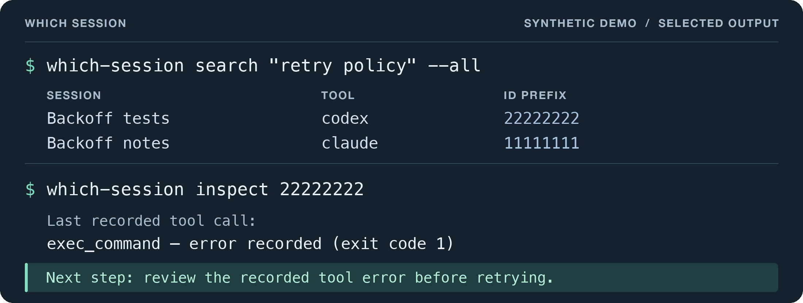

# Which Session

Find a Claude Code or Codex conversation by a phrase you remember, see where it stopped, and get the command to reopen it in its original project. Use the `sessions` skill inside either agent or run `which-session` in your terminal. All three search the same local histories.



## Install on macOS or Linux

One installation adds the terminal command and the `sessions` skill for both Claude Code and Codex. You can use whichever app you already have. A session is a chat that one of those apps saved on this computer.

**1. Download and unpack the folder.** Open the ZIP from your Downloads folder. On Linux, you can right-click it and choose **Extract Here**. Find the extracted folder that contains `install.py`, rename that folder to `which-session`, and move it into **Documents** in your home folder. Keep it there after setup. The installer links your apps to those files. [Download Which Session as a ZIP](https://github.com/Gonzillaaa/which-session/archive/refs/heads/main.zip)

**2. Open Terminal and check Python.** On a Mac, press **Command + Space**, type **Terminal**, and press **Return**. On Linux, open **Terminal** from the applications menu. Paste the following line and press **Return**.

```sh
python3 --version
```

Continue if you see Python 3.9 or newer, such as 3.12. If the command is missing or the version is older, install Python 3 using your Linux distribution’s software manager or the macOS installer. Reopen Terminal and repeat the check. [Download Python for macOS](https://www.python.org/downloads/macos/)

**3. Run the installer.** Paste this line and press **Return**.

```sh
python3 "$HOME/Documents/which-session/install.py"
```

You should see lines beginning with `Linked` or `Already linked`. If Python says it cannot open the file, check that **Documents → which-session → install.py** exists. An extra folder inside `which-session` is a common reason for that message.

**4. Check that it worked.** Paste this in Terminal. It should print `which-session` followed by the version number.

```sh
"$HOME/.local/bin/which-session" --version
```

Open a **new chat** in the app you use. In Claude Code, type `/sessions:version`. In Codex, type `$sessions version`. You should see the same version as in Terminal. Then try a request from the table below.

## Use the skill in Claude Code or Codex

Both agents load the same skill instructions, Python code and settings. In the same folder, with access to the same histories, they can list, search and inspect the same conversations. To ask in your own words, type `/sessions list my last four sessions` in Claude Code or `$sessions list my last four sessions` in Codex. Claude Code also offers a shortcut for each of the five actions.

| What you want to do | Claude Code | Codex |
| --- | --- | --- |
| List your last four sessions from the past week | `/sessions:list 7 4` | `$sessions list my last four sessions from the past week` |
| Find a phrase from the past month | `/sessions:search "retry policy" --days 30` | `$sessions find "retry policy" from the past 30 days` |
| See where a session stopped | `/sessions:inspect ID` | `$sessions inspect ID` |
| Show what you can ask | `/sessions:help` | `$sessions help` |
| Check the installed version | `/sessions:version` | `$sessions version` |

The skill returns a readable table with one row per conversation. For example, ask Codex `$sessions show my last four Claude sessions in this project`, or use `/sessions:list 7 4 --here --source claude` in Claude Code.

Replace `ID` with a full ID or a unique prefix from the results. Inspection shows the last recorded action and, when it can identify the original session and folder, prints the resume command. Run that command in your terminal when you want to reopen the conversation.

## Try it in the terminal

From the installed ZIP, run `"$HOME/.local/bin/which-session" list` in Terminal to browse your own sessions. Wherever this guide uses `which-session`, you can use that full path. If you are already in the downloaded project folder, these commands work directly. Replace the quoted phrase with one you remember.

```sh
./which-session list
./which-session search "retry policy" --days 30
```

`list` opens a keyboard browser in your terminal. Type part of a title or folder to filter, use **↑** and **↓** to preview a session, then press **Enter** to inspect it or **Esc** to return to your shell.

For a table you can copy, run `which-session list --plain`. The columns fit your terminal, with full IDs on their own lines in narrow windows. Piping `list` produces Markdown automatically. Use `which-session list --json` for scripts.

To inspect a search result, type `which-session inspect ` followed by its ID, then press **Return**. Inspection prints a resume command when it can identify the original session and folder. Run that command yourself to reopen the conversation.

If your history is empty, try the same workflow with two disposable sessions. The demo shows an interrupted Claude Code edit and a failed Codex command. [Demo details](examples/README.md)

```sh
python3 examples/demo.py
```

For terminal usage or the installed version, run `which-session help` or `which-session --version`.

## Browse recent sessions

`which-session list` shows the past seven days, most recently active first. Use `which-session list --here` to start in the current project. The preview shows the selected conversation’s last user request, last recorded tool call and outcome, full session ID, and available resume instructions. The earlier `pick` command is an alias for `list`.

On narrow screens, the preview heading shows the selected session’s details that don’t fit in the list. Use **Page Up** and **Page Down** to scroll a long preview.

### Recurring jobs

In the terminal, `list` combines repeated runs of a known job in the same project and agent. For example, six heartbeat runs appear as **Heartbeat runner · 6 runs** at the position of the latest run. The group's time and ID belong to that run. Press **Right** or **Enter** to expand a group and select an older run. **Left** collapses it.

Use `which-session list --ungrouped` for one row per transcript. Search results, piped Markdown and JSON also show individual sessions. The browser includes every eligible entry. Printed output defaults to 15. Pass `--limit N` to set either limit. Each collapsed group counts as one entry.

## Terminal command reference

| Command | What it does |
| --- | --- |
| `which-session list` | Browse recent sessions, newest activity first. `pick` is an alias and accepts the same options. |
| `which-session search "retry policy"` | Find a literal phrase in user or assistant messages, ignoring case. Shows one excerpt per session, ordered by the most recent matching message. |
| `which-session inspect ID` | Show recent messages, tool outcomes and recovery instructions. Accepts a full ID or a unique prefix from any date. `tail` is an alias. |
| `which-session help` | List the commands. `-h` and `--help` also work. Use `which-session search --help`, for example, for one command’s options. |
| `which-session version` | Print the installed version. `which-session --version` does the same thing. |

| Option | Applies to | What it selects |
| --- | --- | --- |
| `--days N` | list, search | Look back N days from now. The default is 7. Try `--days 30` to find an older conversation. |
| `--limit N` | list, search | Return up to N entries. Printed output defaults to 15. An interactive list starts with all eligible entries. |
| `--here` | list, search | Only sessions whose original folder is your current directory. |
| `--folder TEXT` | list, search | Match any part of the project path, ignoring case. Quote names containing spaces. |
| `--source claude`, `--source codex`, `--source all` | list, search | Choose one agent or both. The default is both. |
| `--all` | list, search | Include background workers, temporary projects, and empty or undated sessions. The date window still applies to dated sessions. Search still requires a matching message. |
| `--json` | list, search | Print individual session records for a script. |
| `--plain` | list | Print a table and return to the shell. |
| `--ungrouped` | list | Show recurring runs separately. Combine with `--plain` to print every run on its own row. |
| `--n N` | inspect | Show up to N recent user or assistant messages. The default is 4. |
| `--file PATH` | inspect | Choose the exact transcript file when an ID matches several copies. Use one of the commands printed by `inspect`. |

For example, `which-session search "retry policy" --days 30 --source codex` searches one agent for the past month. `which-session list --plain --here --limit 5` prints the five most recent entries from the current project.

Inside a checkout, `./which-session` and `./sessions` run the same program. The installed terminal command is named `which-session`.

## Updating or removing an installation

- **ZIP install.** To update, first run `python3 "$HOME/Documents/which-session/install.py" --uninstall` while the old folder is still in place. Move the old program folder aside, then follow the ZIP steps with the new folder. To uninstall without updating, stop after the uninstall command. It removes the links the installer owns and preserves your conversations.
- **Git install.** To install from Git, run the three lines below in the parent folder where you want to keep the project. For future updates, run `git pull --ff-only` and then `python3 install.py` inside the project. Use `python3 install.py --uninstall` there to remove its links.
- **Terminal says “command not found.”** The full path from step 4 works in any directory. For the shorter command in Bash or Zsh, run `export PATH="$HOME/.local/bin:$PATH"`. To keep it for future terminals, add that line to your shell’s startup file, usually `~/.zshrc` or `~/.bashrc`.
- **Installer reports a conflict.** It prints the existing file or link it found. If you previously installed Which Session from a different folder, run that copy’s uninstall command first. Leave unrelated files in place.

```sh
git clone https://github.com/Gonzillaaa/which-session.git
cd which-session
python3 install.py
```

The installer links the CLI to `~/.local/bin/which-session`, the shared skill to `~/.claude/skills/sessions` and `~/.codex/skills/sessions`, and Claude’s slash commands to `~/.claude/commands/sessions/`. For a custom installation, set `CLAUDE_CONFIG_DIR` or `CODEX_HOME` before installing. Use `--bin-dir DIRECTORY` to choose a different folder for the terminal command. The installation receipt lives under `XDG_STATE_HOME` (default `~/.local/state`). Use the same settings to uninstall. Run `python3 install.py --help` to see installer options.

## History and privacy

The CLI reads transcripts locally without changing them. It looks for Claude Code project logs in `~/.claude/projects` and dated Codex rollouts in `~/.codex/sessions`. Set `CLAUDE_CONFIG_DIR` or `CODEX_HOME` for custom locations. Separately archived rollouts and cloud-only conversations are outside this search.

A list includes project names and full session IDs. A search adds matching text. Inspection shows recent exchanges and paths. JSON output from list or search also includes the full transcript path, working directory and last user message. Excerpts you display inside a hosted agent become part of that conversation.

## Why Python?

Claude Code and Codex both write one JSON record per line, but they represent messages and tool results differently. To tell you whether an interrupted command actually failed, Which Session has to match the tool call to its result by ID. Python's standard library handles JSON parsing, timestamps and shell quoting for paths such as `Jane's project`. A shell script would need its own JSON handling or an extra tool such as `jq`. The CLI and both agent integrations reuse the same Python parser.

## Development and feedback

The terminal launcher and both skills enter through `skills/sessions/scripts/sessions.py`. The parser in `transcript.py` reads Claude and Codex events. The CLI sorts and filters those records, then passes them to the table or keyboard browser. The browser reads the selected transcript for its preview and passes the selected ID and path to inspection.

The `recurring_jobs` array in the skill settings defines each job's display `name` and literal `opening`. The first user message must begin with that opening followed by whitespace or the end of the message. Use the complete invocation to distinguish one job from another. An empty array disables grouping. [Skill settings](skills/sessions/scripts/settings.json)

```sh
uv run --with-requirements requirements-dev.txt pytest -q
uv run --with-requirements requirements-dev.txt ruff check . which-session
```

Release maintainers can follow the [release checklist](RELEASE-CHECKLIST.md) and read the [release notes](RELEASE-NOTES.md).

For a bug report, include your OS, agent version, `which-session --version`, the command and the result you expected. A synthetic example helps others reproduce it. [Report an issue](https://github.com/Gonzillaaa/which-session/issues) · [MIT license](LICENSE)
